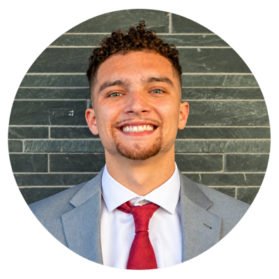

# Meetings

Meetings are **open to the public** and we encourage anyone to join: beginners,
practitioners, researchers — all are welcome.

<!-- TODO: update the term, day, time, room, and Zoom link below each semester. -->

## Current schedule

<table class="schedule">
  <tbody>
    <tr><th scope="row">Term</th><td>Fall 2026</td></tr>
    <tr><th scope="row">Day</th><td>Most weeks on Thursday</td></tr>
    <tr><th scope="row">Time</th><td>7:00 pm &ndash; 8:00 pm</td></tr>
    <tr><th scope="row">Room</th><td>TBD</td></tr>
    <tr><th scope="row">Online</th><td><a href="https://usfca.zoom.us/j/86446059346?jst=3">Join on Zoom</a></td></tr>
  </tbody>
</table>

Let us know if you would like to meet in person and we will find a room.

## Next meeting

**Project check in**

Featured presentation: Unified Computational Framework for Modeling Human Conversation — Thursday, November 5, 7:00 pm

Presenter: AJ Alston

## What happens at a meeting

Our meetings generally revolve around:

* Project updates from lab members
* Open discussion and problem-solving
* Short tutorials on tools and techniques
* Coverage of the latest research in our fields of study

## Reading Groups

Throughout the semester, we host reading groups to explore current
developments in the industry.

**Why should you attend?**

* Discover topics you are interested in and want to work on.
* Form ideas for research projects that you're passionate about.
* Practice your skills in presenting and speaking about research.

### This week's presentation

**Toward a Unified Computational Framework for Modeling Human Conversation**.
Presented by **AJ Alston**.

Human conversation is shaped by individual speaking behaviors, interactions
between participants, communicative settings, and the ways discourse is
organized. This presentation introduces an ongoing research effort to develop a
unified computational framework connecting four dimensions of conversational
variation: speaker characteristics and behavior, interactional dynamics,
register, and genre. Drawing on sociolinguistics, psychology, discourse theory
and computational approaches, the research explores how these dimensions can be
systematically represented, measured and analyzed to better understand human
communication patterns.

The primary goal is to help individuals develop greater awareness of their own
communication behaviors, improve interpersonal understanding, and maximize their
communicative potential. A broader, long-term objective is to apply these
insights toward intelligent systems that speed up the training of professionals
in the workforce.

### About the presenter

  
  

**AJ Alston** is a researcher and a University of San Francisco alumnus with a
B.S. in Physics and minors in Computer Science and African American Studies. He
currently works as a tutor while conducting independent research on
computational approaches to understanding and modeling human conversation. His
broader research interests include human conversational dynamics, social and
cognitive psychology, and human-computer interaction, along with cybersecurity,
national security, quantum computing, computer graphics and visualization, the
safety and oversight of autonomous systems, and artificial intelligence.

  

## Questions?

Contact the [lab manager](/people/) and they'll point you in the right
direction.
