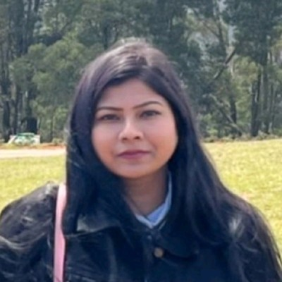

# Meetings

Meetings are **open to the public** and we encourage anyone to join: beginners,
practitioners, researchers — all are welcome.

<!-- TODO: update the term, day, time, room, and Zoom link below each semester. -->

## Current schedule

<table class="schedule">
  <tbody>
    <tr><th scope="row">Term</th><td>Fall 2026</td></tr>
    <tr><th scope="row">Day</th><td>Most weeks on Thursday</td></tr>
    <tr><th scope="row">Time</th><td>7:00 pm &ndash; 8:00 pm</td></tr>
    <tr><th scope="row">Room</th><td>TBD</td></tr>
    <tr><th scope="row">Online</th><td><a href="https://usfca.zoom.us/j/86446059346?jst=3">Join on Zoom</a></td></tr>
  </tbody>
</table>

Let us know if you would like to meet in person and we will find a room.

## Next meeting

**Project check in and Reading Group:** [Beyond Perturbation Robustness: Biological Equivalence in Genomic Foundation Models](https://neurips.cc/virtual/2026/163728) — Thursday, October 22, 7:00 pm

## What happens at a meeting

Our meetings generally revolve around:

* Project updates from lab members
* Open discussion and problem-solving
* Short tutorials on tools and techniques
* Coverage of the latest research in our fields of study

## Reading Groups

Throughout the semester, we host reading groups to explore current
developments in the industry.

**Why should you attend?**

* Discover topics you are interested in and want to work on.
* Form ideas for research projects that you're passionate about.
* Practice your skills in presenting and speaking about research.

### This week's paper

[Beyond Perturbation Robustness: Biological Equivalence in Genomic Foundation Models](https://neurips.cc/virtual/2026/163728) — Padmaja Mohanty, WiML Workshop at NeurIPS 2026.
Presented by **Padmaja Mohanty**.

Different DNA sequences can encode the same protein. This paper asks whether
genomic foundation models recognize that, and whether their learned
representations capture the biological meaning rather than just similarity in
the DNA. Mohanty tests four models on 91 human coding sequences and finds that
two of them do no better than chance: a model that barely changes under DNA
edits has not necessarily learned the biology.

### About the presenter

  
  

**Padmaja Mohanty** is a Master's student in Computer Science at the University
of San Francisco working at the intersection of AI, biology and healthcare. Her
research focuses on understanding what AI models learn about biological systems,
how they process information and whether their representations capture
meaningful biological relationships and mechanisms. Two of her projects on
genomic foundation models were accepted at NeurIPS 2026 workshops: a mechanistic
interpretability study of how SpliceBERT processes RNA splicing signals, and
this week's paper.

  

## Questions?

Contact the [lab manager](/people/) and they'll point you in the right
direction.
